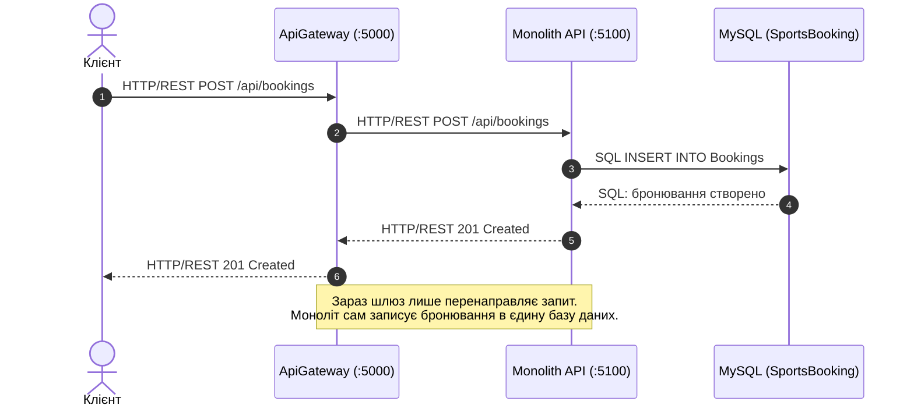
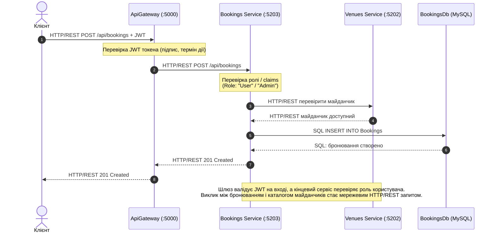

# Архітектурні діаграми (ЛР0)

Усі діаграми збережено у вихідному форматі draw.io: [architecture.drawio](architecture.drawio) (містить 3 вкладки з повною розміткою).
Нижче наведено їх візуальне відображення у форматі Mermaid для швидкого перегляду безпосередньо у Markdown.

---

## 1. Діаграма композиції (Контейнерна, рівень C4)

Показує поточний стан системи (ЛР0) та цільову архітектуру після винесення мікросервісів на наступних лабораторних роботах.

```mermaid
flowchart TB
    subgraph Clients["Клієнти"]
        Client["Клієнт (Web / Mobile)"]
    end

    subgraph GatewayLayer["Рівень шлюзу"]
        Gateway["ApiGateway (Ocelot)<br/>порт: 5000<br/><b>[Вже існує]</b>"]
    end

    subgraph CurrentSystem["Поточний стан (ЛР0)"]
        Monolith["Monolith API<br/>порт: 5100<br/>(Auth, Venues, Bookings)<br/><b>[Вже існує]</b>"]
        DB[(MySQL: SportsBooking<br/>Users, Venues, Bookings<br/><b>[Вже існує]</b>)]
    end

    subgraph FutureServices["Цільові сервіси (Майбутні ЛР)"]
        AuthSvc["Auth Service<br/>порт: 5201<br/><i>[Майбутнє]</i>"]
        VenuesSvc["Venues Service<br/>порт: 5202<br/><i>[Майбутнє]</i>"]
        BookingsSvc["Bookings Service<br/>порт: 5203<br/><i>[Майбутнє]</i>"]

        AuthDB[(MySQL: AuthDb)]
        VenuesDB[(MySQL: VenuesDb)]
        BookingsDB[(MySQL: BookingsDb)]
    end

    Client -->|HTTP/REST :5000| Gateway
    Gateway -->|HTTP/REST :5100<br/>/api/*| Monolith
    Monolith -->|TCP 3306 / SQL| DB

    Gateway -.->|HTTP/REST :5201<br/>/api/auth/*| AuthSvc
    Gateway -.->|HTTP/REST :5202<br/>/api/venues/*| VenuesSvc
    Gateway -.->|HTTP/REST :5203<br/>/api/bookings/*| BookingsSvc

    AuthSvc -.->|SQL| AuthDB
    VenuesSvc -.->|SQL| VenuesDB
    BookingsSvc -.->|SQL| BookingsDB
    BookingsSvc -.->|HTTP/REST: перевірити майданчик| VenuesSvc

    classDef current fill:#d4edda,stroke:#28a745,stroke-width:2px;
    classDef future fill:#fff3cd,stroke:#ffc107,stroke-width:2px,stroke-dasharray: 5 5;
    class Gateway,Monolith,DB current;
    class AuthSvc,VenuesSvc,BookingsSvc,AuthDB,VenuesDB,BookingsDB future;
```

---

## 2. Діаграма послідовностей: Створення бронювання зараз (ЛР0)

Сценарій: створення бронювання через поточний моноліт.



---

## 3. Діаграма послідовностей: Створення бронювання після поділу

Сценарій: створення бронювання після декомпозиції на мікросервіси.


