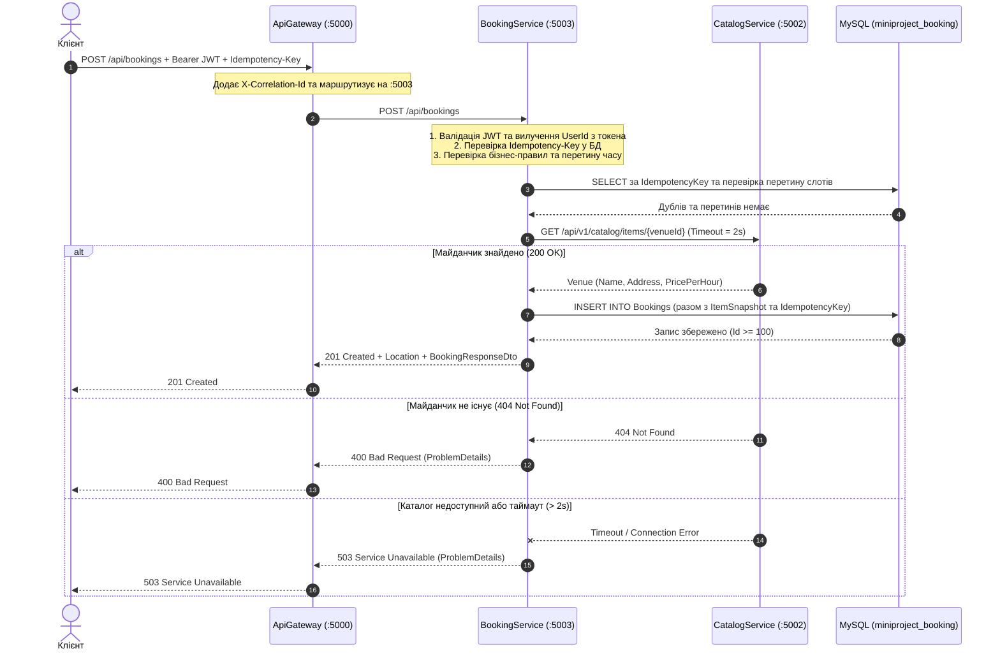

# Архітектурні діаграми (Оновлено для ЛР2)

Усі діаграми збережено у вихідному форматі draw.io: [architecture.drawio](architecture.drawio).
Нижче наведено оновлене візуальне відображення архітектури системи після винесення `AuthService` (ЛР1), `CatalogService` (ЛР1) та операційного сервісу `BookingService` (ЛР2).

---

## 1. Діаграма компонентів та баз даних (Контейнерна, рівень C4 — Стан у ЛР2)

Усі три доменні сервіси (`AuthService`, `CatalogService`, `BookingService`) винесені з моноліту та мають власні ізольовані бази даних MySQL за принципом *Database per Service*.

```mermaid
flowchart TB
    subgraph Clients["Клієнти"]
        Client["Клієнт (Web / Mobile / HTTP)"]
    end

    subgraph GatewayLayer["Рівень шлюзу"]
        Gateway["ApiGateway (Ocelot)<br/>порт: 5000<br/>Генерація X-Correlation-Id"]
    end

    subgraph Microservices["Мікросервіси (Активні у ЛР2)"]
        AuthSvc["AuthService<br/>порт: 5001<br/>JWT, Користувачі, Ролі"]
        CatalogSvc["CatalogService<br/>порт: 5002<br/>Майданчики (Venues), Категорії"]
        BookingSvc["BookingService (Новий у ЛР2)<br/>порт: 5003<br/>Бронювання, Ідемпотентність, ItemSnapshot"]
    end

    subgraph Databases["Ізольовані бази даних MySQL (:3306)"]
        AuthDB[(MySQL: miniproject_auth<br/>Users, Roles, RefreshTokens)]
        CatalogDB[(MySQL: miniproject_catalog<br/>Venues, Categories)]
        BookingDB[(MySQL: miniproject_booking<br/>Bookings + ItemSnapshot)]
    end

    subgraph Legacy["Залишок моноліту (На час перевірки Strangler Fig)"]
        Monolith["Monolith API<br/>порт: 5100"]
        MonoDB[(MySQL: SportsBooking)]
    end

    Client -->|HTTP/REST :5000| Gateway
    Gateway -->|/api/v1/auth/**, /api/v1/users/** :5001| AuthSvc
    Gateway -->|/api/v1/catalog/** :5002| CatalogSvc
    Gateway -->|/api/bookings/** :5003| BookingSvc
    Gateway -.->|Fallback /api/** :5100| Monolith

    AuthSvc -->|EF Core / SQL| AuthDB
    CatalogSvc -->|EF Core / SQL| CatalogDB
    BookingSvc -->|EF Core / SQL| BookingDB
    Monolith -.->|SQL| MonoDB

    BookingSvc -->|HTTP GET /api/v1/catalog/items/{id}<br/>Timeout: 2s + X-Correlation-Id| CatalogSvc

    classDef active fill:#d4edda,stroke:#28a745,stroke-width:2px;
    classDef legacy fill:#f8f9fa,stroke:#6c757d,stroke-width:1px,stroke-dasharray: 5 5;
    class Gateway,AuthSvc,CatalogSvc,BookingSvc,AuthDB,CatalogDB,BookingDB active;
    class Monolith,MonoDB legacy;
```

---

## 2. Діаграма послідовностей: Створення бронювання у `BookingService` (ЛР2)

Сценарій: клієнт створює бронювання через шлюз `ApiGateway (:5000)` із заголовком `Idempotency-Key`.


